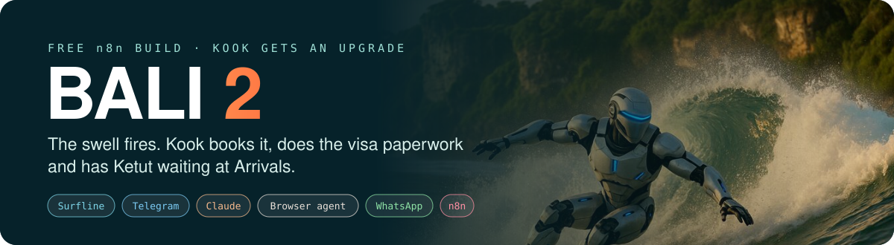
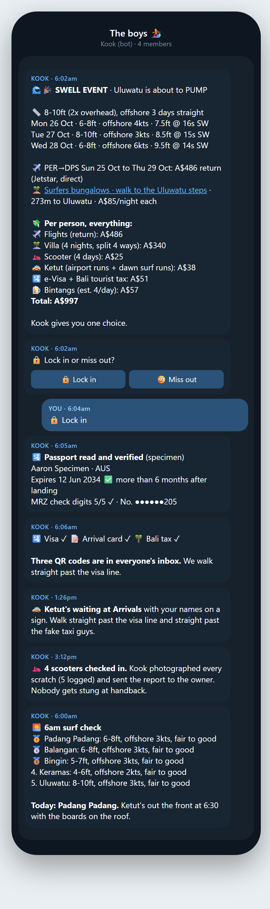
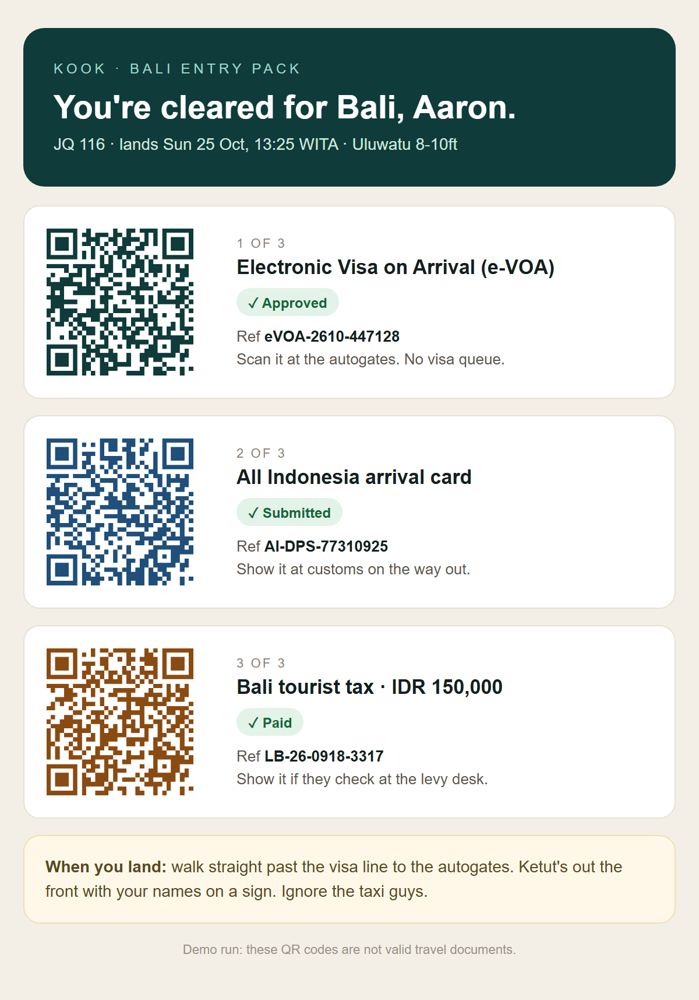
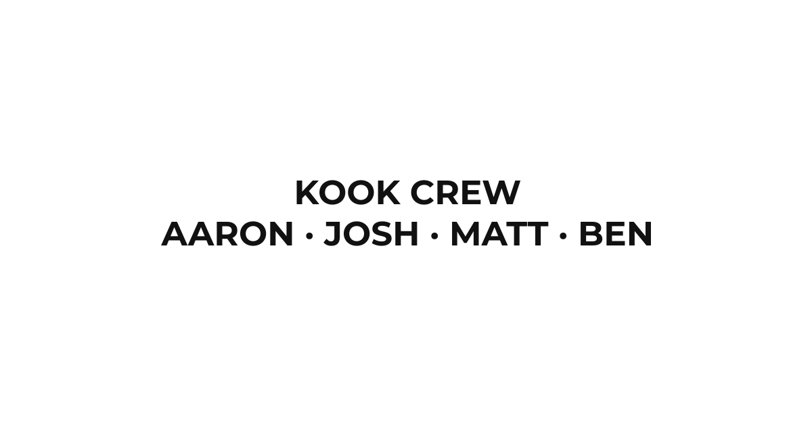
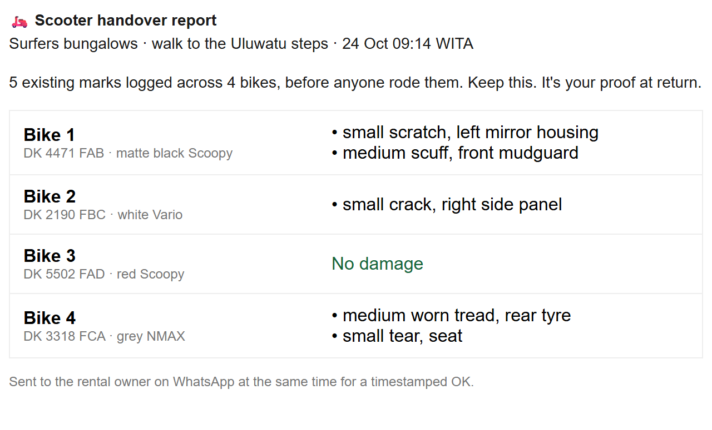
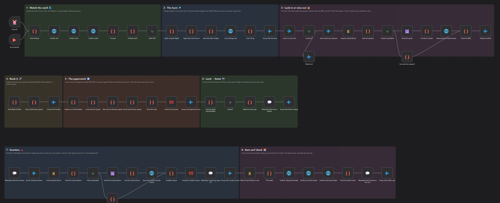

  

  <b>When Uluwatu goes six foot and offshore for three days straight, Kook books the trip, 
  sorts everyone's e-Visa, arrival card and Bali tax, and has Ketut waiting at Arrivals 
  with your names on a sign. Then he picks the cleanest break every morning at 6am.</b>

  
  &nbsp;
  

  
  
  
  
  

---

## 👋 Never used GitHub? You're in the right place.

This page is just where the file lives. **You don't need to code, and you don't need a GitHub account.**

| | Step | What to do |
|:-:|---|---|
| **1** | **Get n8n** | n8n is the free app that runs automations like this one. The easiest way in is the free trial of [n8n Cloud](https://n8n.io/): sign up, and you're looking at an empty canvas. |
| **2** | **Download Kook** | Hit the orange **Download the demo** button above. You get a small file ending in `.json`. That file *is* the automation. |
| **3** | **Drop him in** | In n8n, open a new workflow, click the **⋯** menu (top right) → **Import from File**, and pick the file. Kook appears on your screen, ready to go. |

Then follow **[Try the demo](#-try-the-demo-about-15-minutes)** below. One click runs the whole trip, start to finish, and every message comes to **your own phone**.

---

## 📱 What it actually sends

<table>
<tr>
<td width="50%" valign="top"></td>
<td width="50%" valign="top">
 <b>Everyone's inbox:</b> three QR codes, so you walk straight past the visa line.  
 <b>Ketut's phone:</b> the sign he holds up at Arrivals.  
 <b>The scooter guy:</b> every scratch logged before anyone rides.
</td>
</tr>
</table>

---

## 🌴 The trip, step by step

| | Kook… | In plain English |
|:-:|---|---|
| 🌊 | **watches the swell** | Checks Surfline every 6 hours. Only fires when the break is **6ft+ and offshore, 3 days in a row**. |
| 🔎 | **does the hunt** | Finds the cheapest flights from your home town and the villa **closest to the surf, within budget**. |
| 💸 | **prices everything** | Flights, villa, scooters, driver, visa, tax and **estimated beers**, per person, at today's exchange rate. |
| 🔒 | **gives you one choice** | Lock in or miss out. |
| 🛂 | **grabs your passport** | You snap a photo. Claude reads it, then Kook **double-checks every digit** against the check numbers printed on every passport. |
| ✈️ | **books it** | Holds the seats with everyone's passport attached, and requests the villa. |
| 📝 | **does the paperwork** | Applies for each **e-Visa**, pays the **Bali tourist tax**, and fills in the **arrival card** the moment it opens, 3 days before you fly. |
| 🚕 | **lines up Ketut** | Tracks your flight. The second you land, Ketut gets a WhatsApp with **your names on a sign**. |
| 🛵 | **sorts the scooters** | Books one each. At handover, Claude logs **every scratch** from your photos and the owner signs off. |
| 🌅 | **calls the surf** | Every morning at 6am it rates 5 breaks and sends Ketut to the cleanest, boards on the roof. |
| 🧹 | **cleans up** | Deletes every passport and scan the day the trip ends. |

```mermaid
flowchart LR
    A["🌊 6ft + offshore<br/>3 days"] --> B["🔎 Flights + villa<br/><i>closest to the surf</i>"]
    B --> C["💸 Every cost<br/>per person"]
    C --> D{"🔒 Lock in<br/>or miss out?"}
    D -->|in| E["🛂 Passport<br/><i>read + verified</i>"]
    E --> F["✈️ Seats held"]
    F --> G["📝 e-Visa · tax ·<br/>arrival card"]
    G --> H["📧 3 QR codes"]
    H --> I["🛬 Landed →<br/>🚕 Ketut + sign"]
    I --> J["🛵 Scooters<br/><i>every scratch logged</i>"]
    J --> K["🌅 6am: cleanest<br/>break → Ketut"]

    style A fill:#0f3b3a,stroke:#0a2726,color:#fff
    style B fill:#1f4f7a,stroke:#163a5a,color:#fff
    style C fill:#1f4f7a,stroke:#163a5a,color:#fff
    style D fill:#FF7A45,stroke:#c4552a,color:#fff
    style E fill:#D97757,stroke:#a8553a,color:#fff
    style F fill:#2b5278,stroke:#1d3a57,color:#fff
    style G fill:#8a4b12,stroke:#5e330c,color:#fff
    style H fill:#8a4b12,stroke:#5e330c,color:#fff
    style I fill:#25D366,stroke:#1a9e4b,color:#0b2b16
    style J fill:#25D366,stroke:#1a9e4b,color:#0b2b16
    style K fill:#FFC56B,stroke:#c79540,color:#3b2a00
```

---

## 🖥️ What it looks like inside n8n

  

---

## 🧠 How Kook does the "impossible" bits

There's no app you can plug into for an Indonesian visa. So here's how he gets around it, in plain English.

- **The visa, tax and arrival card.** Kook uses a *browser agent*: an AI that drives a real web browser and fills in the forms the way you would. It's only allowed on the **official government sites**: `evisa.imigrasi.go.id`, `lovebali.baliprov.go.id` and `allindonesia.imigrasi.go.id`. That matters, because the look-alike sites charge you triple.
- **Paying without handing an AI your card.** Each person gets a **brand-new virtual card that only works once**, loaded with exactly the visa + tax (IDR 650,000, about A$51). The agent can only type it into those two payment pages, and it's dead after one charge.
- **Verification codes.** The agent gets its own email inbox, so it can read the code the visa site sends.
- **When a site gets stuck** (a CAPTCHA, a changed page), it **stops and messages you**. One click from you and it carries on. It never guesses.
- **Your passport.** Claude reads the two lines of code at the bottom of your passport photo page, and then Kook checks them against the **five check numbers** built into every passport. One wrong digit and it asks you to retake the photo. A fake passport number can't sneak through to a visa application.
- **Ketut.** WhatsApp only lets a business send a normal message to someone who's messaged it in the last 24 hours. Ketut hasn't, so Kook uses **pre-approved WhatsApp message templates**. That's the official, allowed way to do it.

---

## 🎬 Try the demo (about 15 minutes)

The demo runs the whole trip in **one click** and sends everything to **you**: the group chat, Ketut's WhatsApps and the scooter guy's all land in your Telegram, and the QR codes land in your inbox. **It costs nothing to run.** The bits that would spend real money (booking flights, paying for visas) are simulated, and each one says so.

**What's real in the demo:** the live Surfline forecast, today's exchange rate, the lock-in button, Claude reading your passport photo and checking every digit, Claude logging every scooter scratch, Ketut's sign, the QR email and the 6am surf call.

1. **Make a Telegram bot** (2 min). In Telegram, message **@BotFather** → send `/newbot` → follow the prompts. It gives you a **token**. Then message your new bot once, and open `https://api.telegram.org/bot<YOUR TOKEN>/getUpdates` in a browser: the number after `"chat":{"id":` is your **chat id**.
2. **Import the demo** (step 3 at the top).
3. **Connect your accounts.** Any node with a red warning needs one. Click it → **Credential** → **Create new**:
   - **Telegram**: your bot token
   - **Anthropic** (Claude): an API key from [console.anthropic.com](https://console.anthropic.com/). Only used if you set `ZERO_SPEND: false` so Claude reads your real passport and scooter photos (about 2c a photo).
   - **Gmail**: sign in with Google
4. **Open ⚙️ Kook settings** (third node) and put in your Telegram chat id and email.
5. Click **Execute workflow**. Tap **🔒 Lock in** in Telegram, snap your passport (or press Submit with nothing to use a sample one), and watch your phone.

> 🌊 **Flat when you try it?** The demo knows. If the real forecast doesn't hit 6ft for 3 days, it borrows a pumping week so you still see the whole thing. Set `FORCE_SWELL: false` to only ever use the real forecast.

---

<b>🛠️ Running the full build for a real trip (click to open)</b>

 

The full build is the same chain with every simulation swapped for the real service. It runs for weeks: n8n's **Wait** nodes park it between steps (the lock-in deadline, the arrival card window, landing day, every 6am).

**Accounts you'll need:**

| Service | What it does | n8n credential |
|---|---|---|
| Telegram bot | the boys' group chat | Telegram API (add the bot to the group) |
| Claude | reads passports and scooter photos | Anthropic API |
| Gmail | sends the entry packs | Gmail OAuth2 |
| Apify | finds the flights and villas | Header Auth: `Authorization: Bearer <token>` |
| Browser Use | the browser agent | Header Auth: `X-Browser-Use-API-Key: <key>` |
| Duffel | holds the seats | Header Auth: `Authorization: Bearer <token>` |
| Airwallex | the one-use cards | Custom Auth: `{"headers":{"x-client-id":"...","x-api-key":"..."}}` |
| AeroDataBox | live flight tracking | Header Auth: `X-RapidAPI-Key: <key>` |
| WhatsApp Cloud API | messages Ketut | Header Auth: `Authorization: Bearer <token>` |

**Two data tables** (n8n → **Data tables**, every column text):
- `kook_trips`: `trip_id`, `workspace_id`, `status`, `depart_date`
- `kook_lockins`: `trip_id`, `name`, `email`, `phone`, `given`, `surname`, `nationality`, `number`, `sex`, `dob`, `expiry`

**Four WhatsApp templates** (WhatsApp Manager → Message templates, category *Utility*, English):
- `kook_landed` (image header): `{{1}} has landed. {{2}} of us, visas all done. Heading to {{3}}. Sign attached, see you at Arrivals!`
- `kook_scooters`: `Hi! Could we get {{1}} scooters delivered to {{2}} for {{3}} days, with surf racks? We'll photograph them at handover.`
- `kook_handover`: `Scooter handover report: {{1}} Please reply OK to confirm.`
- `kook_surf_call`: `Morning! Today's break is {{1}}. Pick up 6:30 at the villa please, {{2}} boards on the roof.`

**Then:** log a Browser Use profile in to your Airbnb (so it can request the villa), fill in **⚙️ Kook settings** and the four lines in **Lock-in settings**, and **activate**. Each mate locks in through the Lock-in form link Kook posts in the chat.

**Honest limits:**
- The browser agent is quick, not magic. When a government site changes or throws a CAPTCHA, it stops and asks you.
- e-VOA eligibility depends on your passport. Australians, Kiwis, Brits, Americans and most of Europe qualify. Check yours.
- Not every fare can be held, and Duffel doesn't cover every airline. If it can't hold one, it tells you.
- Airbnb has no booking API, so the villa is booked by the browser agent on your own account.
- Card numbers pass through the run, so this workflow ships with saving successful runs **off**. Keep it that way.

---

## ❓ Questions people ask

<b>Do I need to know how to code?</b>
 No. You import a file and fill in a settings box. The code is already written.

<b>What does it cost?</b>
 The workflow is free. n8n Cloud has a free trial, or you can run n8n yourself for free. The demo costs nothing to run. Switch on the real passport read and it's about 2c a photo. On a real trip the visa and tax cost the same as doing it yourself (IDR 650,000, about A$51 each), plus a few dollars of browser-agent time.

<b>Is it safe to give it my passport?</b>
 The passport photo goes to Claude to be read, and the details are used for your flight and visa only. They're deleted the day the trip ends. The payment cards work once, for one exact amount, on two government sites. It's your n8n, your accounts and your keys, and nothing passes through us.

<b>Is the visa bit allowed?</b>
 You're applying for yourself on the official government sites, with your own details, and paying the official price. Kook just does the typing. Always check the current entry rules for your passport before you fly.

<b>Can I use it for a different break, or a different country?</b>
 Yes for the break: change the Surfline spot in ⚙️ Kook settings. Other countries have different visa sites, so you'd rewrite the browser agent's instructions.

<b>I'm stuck.</b>
 Screenshot the node with the red warning and send it to <a href="https://www.instagram.com/aaronautomates/">@aaronautomates</a> on Instagram.

---

Free under the MIT licence. Built by <a href="https://myceliumai.com.au">Mycelium AI</a> in Perth · more builds at <a href="https://aaronautomates.com.au">aaronautomates.com.au</a> · follow along on Instagram <a href="https://www.instagram.com/aaronautomates/">@aaronautomates</a> 
Kook's not a travel agent. He just doesn't like queues.

